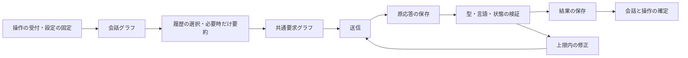

# 会話の実行・保存とコンテンツ設定

対象: REQ-CHAT-CHECKPOINT、REQ-CONTENT-MODE、REQ-SCENE-TOOLS、REQ-LLM-EFFICIENCY。

## 実行と保存の分担

会話の確定状態と操作の受付・完了は業務テーブルを正本とする。LangGraphの公式SqliteSaverは同じSQLiteファイル内で実行途中の入力と応答を保存する。業務トランザクションの中ではLLM通信やチェックポイントの書き込みを行わない。

会話グラフは、現在状態、必要な履歴、今回の入力を固定する。共通要求グラフは送信・検証・修正を担当し、会話、下書き、英訳、要約で再利用する。グラフはClient内でコンパイルして再利用し、資格情報や実行用の関数を保存状態へ含めない。

モデル、接続先、生成設定のハッシュを操作ごとに照合する。再開時に条件が異なる場合は停止する。原応答が保存済みなら再送せず検証を再開する。受付が不明な送信や失敗した通信は再送しない。検証済み応答の保存に失敗した場合は、保持した結果から会話を確定する。要約まで保存できた中断は、保存済みの入力と応答を確認した上で明示操作から再開する。副作用を含む任意の過去ノードへの巻き戻しは提供しない。

## 履歴と文脈

会話テーブルには定義、現在状態、要約、固定メモ、版を保存する。本文はconversation_turns、行動・提案・外見確認はconversation_eventsに分離する。本文の追加で過去の本文を書き直さず、HTTPの概要取得に全文を含めない。履歴はページ単位で取得し、保存済みの連鎖ハッシュと識別子を確認する。LLM実行では要約の末尾以降と今回の行動だけを読み、人物の確定状態と過去の要約を区別する。

場面の環境、相手の動作、台詞を分ける。応答の先頭で自分の行動案を抽出し、未確定の行動を本文へ公開しない。人物の状態に対応する変化がない動作文は表示しない。人物の現在の外見は一度だけ入力し、不在でも確定した服装や持ち物を失わない。描画では在否と選択した対象から可視情報を取り出す。持ち物は識別子と表示名を持つ物理的な物とし、同じ名前の別物を区別する。約束や知識は固定メモや会話の要約で扱う。

固定メモ、文体、扱う話題、避けたい内容を文脈へ渡す。固定メモを編集しても過去のターンに保存したメモを変更しない。文字数と件数の上限は[入力契約](../../src/backend/src/komaquill/conversations/editing.py)と[会話契約](../../src/backend/src/komaquill/conversations/models.py)を正本とする。

## NSFWと閲覧

NSFWのチェックボックスは設定画面に置き、画面上部に現在の状態を表示する。作業フォルダー単位で保存し、既定はOFFとする。ONで受け付けた生成ではローカルLLMだけを使用し、外部LLMへの自動切替は行わない。NSFW本文や画像をアプリ自身で生成する処理は追加せず、設定済みのLLMとComfyUIへ渡す。

保存物には一般向け、NSFW、未分類の区分を保持する。OFFではNSFWと未分類を一覧・詳細・画像ファイル・会話出力から隠す。既存データの意味を自動判定しない。分類の変更はONで明示的に行い、操作IDと期待する版で競合と重複を防ぐ。生成条件に影響する編集や生成受付はNSFW区分を引き継ぎ、名前だけの編集を生成と扱わない。

操作受付時のNSFW設定は固定する。処理中にOFFへ切り替えても保存と画像回収を続け、閲覧には現在の設定を適用する。Reactは設定変更時に取得中の要求を取り消し、作品のキャッシュを破棄して読み直す。別タブには設定変更を通知する。画像のHTTP応答はno-storeとする。画面を隠すボタンは入力中の文章を保持し、生成設定を変更しない。

## 場面の保存・分岐とエクスポート

場面は確定ターン、人物の状態、固定メモを指定して保存する。分岐は指定ターンまでの履歴を新しい会話へコピーし、元の会話、後続ターン、要約、未確定の提案を変更しない。保存と分岐ではLLMもGPUも呼ばない。

ZIPには会話本文と区分を含め、画像と生成条件は個別に選択する。共有用画像のコピーからPNGメタデータを取り除く。元画像・履歴は変更せず、ZIPの作成が完了してから公開する。生成条件を含めた場合はプロンプト等も共有される。

会話画像は相手、自分と相手、風景から対象を選ぶ。二人の描画はWAIに限定し、主観・客観の視点を指定して受付時の人物と場所を固定する。生成セットとComfyUI標準グラフを使用し、人物同一性や配置の正しさは実画像で別に評価する。

## 移行

起動時に旧DBを暗黙に変換しない。停止を確認して明示的なDB移行を実行し、バックアップ、テーブルの一覧とハッシュ、移行後の照合結果を保存する。旧JSONはexecution_migration_originalsへ保持し、本文とイベントを分離する。旧operations.replyは原本へ退避して削除する。既存の作品・プリセット・画像・作成ジョブは未分類とする。

旧形式の持ち物には名前を変えずに識別子を付ける。物の同一性を過去の文章から推測しない。表現が変わった会話の旧要約とハッシュは原本に保持し、新しい実行の要約には再利用しない。既存のファイル型アーカイブは既定で未分類として隠し、ONで閲覧する。

## 検証範囲

Fakeとlocalhost擬似APIで、再起動、保存失敗、重複操作、設定変更、表示切替、履歴の破損、分岐、コピーの保全を検証する。実LLMの精度、総トークン量、待ち時間、二人の実画像は別の受入とし、操作ごとの許可と上限を必要とする。
