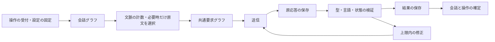

# 会話の実行・保存とコンテンツ設定

対象: REQ-CHAT-CHECKPOINT、REQ-CONTENT-MODE、REQ-SCENE-TOOLS、REQ-LLM-EFFICIENCY、REQ-CONVERSATION-CONTINUITY。

## 実行と保存の分担

会話の確定状態と操作の受付・完了は業務テーブルを正本とする。LangGraphの公式SqliteSaverは同じSQLiteファイル内で実行途中の入力と応答を保存する。業務トランザクションの中ではLLM通信やチェックポイントの書き込みを行わない。

会話グラフは、現在状態、必要な履歴、今回の入力を固定する。共通要求グラフは送信・検証・修正を担当し、会話、下書き、英訳、記憶作成で再利用する。グラフはClient内でコンパイルして再利用し、資格情報や実行用の関数を保存状態へ含めない。

モデル、接続先、生成設定のハッシュを操作ごとに照合する。再開時に条件が異なる場合は停止する。原応答が保存済みなら再送せず検証を再開する。受付が不明な送信や失敗した通信は再送しない。検証済み応答の保存に失敗した場合は、保持した結果から会話を確定する。記憶まで保存できた中断は、保存済みの入力と応答を確認した上で明示操作から再開する。副作用を含む任意の過去ノードへの巻き戻しは提供しない。

受信ログが読めない場合や応答の内容を確認できない場合は再開を許可しない。チェックポイントは操作単位で検証し、読めない操作は識別子と失敗状態を保持する。実行主体の停止を確認してから他の会話の処理を継続し、原本を上書きしない。

## 履歴と文脈

会話テーブルには定義、現在状態、記憶、固定メモ、版を保存する。本文はconversation_turns、行動・提案・外見確認はconversation_eventsに分離する。本文の追加で過去の本文を書き直さず、HTTPの概要取得に全文を含めない。履歴はページ単位で取得し、保存済みの連鎖ハッシュと識別子を確認する。LLM実行では記憶の対象範囲以降と今回の行動だけを読み、人物の確定状態と過去の記憶を区別する。

場面の環境、相手の動作、台詞を分ける。モデルは自分の行動案か、相手と環境の変更差分を返し、自分の行動は確認後に確定する。状態を変えない身振りも動作として表示する。人物の現在の外見は一度だけ入力し、不在でも確定した服装や持ち物を失わない。描画では在否と選択した対象から可視情報を取り出す。持ち物は識別子と表示名を持つ物理的な物とし、同じ名前の別物を区別する。約束や知識は固定メモや原文を参照する記憶で扱う。

現在地は主人公とキャラクターで共有する。明示した移動は受付時に確定する。自然文の即時移動は保存済みの解釈から一度だけ確定し、別のチェックポイントで移動後の返答を生成する。元の受付要求、解釈、移動の事実、返答を対応付け、一つの会話ターンとして保存する。詳しくは[自分の行動と現在の場面](player-actions.md)を参照する。

同席時には、新しい情景・発言・可視動作のいずれもない返答を成功扱いにしない。内部状態だけの変更や、確定済みの自分の行動は相手の返答の代わりにならない。この検証はLLM応答と保存時で共有し、有効な無言の情景描写は維持する。確定行動の直近入力にも両者の現在地を含め、過去の移動と現在の位置を区別する。

自分の行動案は、利用者が現在の状態や継続する意図の変更を明示した場合に限る。質問、意見、条件付きの相談、将来の予定は相手との会話として扱い、その文章を自分の意図へ置き換えない。確定済みの行動は再提案しない。

保存する情景は確定した場面の状態から一度だけ投影する。行動案には確定済みの発言・動作を混在させない。完了済みの履歴は新しい生成条件で再検証しない。未完了の再開では保存した契約・指示・設定を照合し、不一致や矛盾した保存結果を再送せず識別する。他の会話の閲覧と回復は継続する。

固定メモ、文体、扱う話題、避けたい内容を文脈へ渡す。固定メモを編集しても過去のターンに保存したメモを変更しない。文字数と件数の上限は[入力契約](../../src/backend/src/komaquill/domain/conversations/editing.py)と[会話契約](../../src/backend/src/komaquill/domain/conversations/models.py)を正本とする。

直近の履歴と記憶の入力には、発言、台詞、環境、相手の動作、確定した行動を分けて含める。現在の確定状態は別に渡す。履歴の件数だけで記憶を作らず、同じ計数方法で送信前の予算を確認する。連続する同一内容は位置と回数を残して表し、状態やメモが異なる境界は保持する。

履歴は利用者の発言・確定行動をuser、相手の発言・描写をassistantの標準メッセージへ分ける。文脈の計数にも同じ役割を使用する。相手の生成文を利用者の事実や訂正として扱わず、一部の予定を訂正した場合も、変更されていない部分は元の利用者の発言を根拠に保持する。

記憶は原文の引用とターンID・項目・範囲のハッシュを保存し、利用時に元の履歴と照合する。自由文の再要約を行わず、直近の完全な履歴は保持する。選択処理の上限内に収まらない場合はcontext_limit_exceededで停止する。引用の真正性と、モデルが正しく想起する品質は別の受入条件である。

履歴のハッシュは、保存されたJSONから型の既定値を補う前に照合する。記憶が参照する消費済み範囲のハッシュも保存アダプターから取得する。新しい型で旧履歴のハッシュを計算し直さず、過去の本文と保存済みハッシュを保持する。

## NSFWと閲覧

現役・過去・archiveの保存物をすべてNSFWとして扱う。利用者による切替や個別分類、区分による閲覧制限は設けない。新しいエクスポートにも同じ区分を記録する。新規の実LLM送信はローカル接続と操作ごとの明示許可を必要とし、外部LLMへ自動的に切り替えない。

過去の操作に保存されたNSFW条件は当時の実行事実として保持する。現在の分類方針を理由に、送信済み要求、グラフ、原応答、チェックポイントを変更しない。画像応答はno-storeとする。

「画面を隠す」はサイドバー下部に置く。入力とスクロールを保持したまま作業領域を隠し、その外の復帰操作から再表示する。別タブで開いた画像はブラウザーで管理する。

操作の接続条件、行動と発言の受付、固定方針への移行は[操作と接続確認](operations-and-availability.md)を参照する。

## 場面の保存・分岐とエクスポート

場面は確定ターン、人物の状態、固定メモを指定して保存する。分岐は指定ターンまでの履歴を新しい会話へコピーし、元の会話、後続ターン、記憶、未確定の提案を変更しない。保存と分岐ではLLMもGPUも呼ばない。

ZIPには会話本文と区分を含め、画像と生成条件は個別に選択する。共有用画像のコピーからPNGメタデータを取り除く。元画像・履歴は変更せず、ZIPの作成が完了してから公開する。生成条件を含めた場合はプロンプト等も共有される。

会話画像は相手、自分と相手、風景から対象を選ぶ。二人の描画はWAIに限定し、主観・客観の視点を指定して受付時の人物と場所を固定する。生成セットとComfyUI標準グラフを使用し、人物同一性や配置の正しさは実画像で別に評価する。

## 移行

起動時に旧DBを暗黙に変換しない。停止を確認して明示的なDB移行を実行し、バックアップ、テーブルの一覧とハッシュ、移行後の照合結果を保存する。旧JSONはexecution_migration_originalsへ保持し、本文とイベントを分離する。旧operations.replyは原本へ退避して削除する。個別分類の表とNSFW設定を明示移行で廃止する。変更前の設定は原本として保持する。

旧形式の持ち物には名前を変えずに識別子を付ける。物の同一性を過去の文章から推測しない。表現が変わった会話の旧要約とハッシュは原本に保持し、新しい実行の記憶には再利用しない。既存のファイル型アーカイブも固定NSFWとして閲覧する。

## 検証範囲

Fakeとlocalhost擬似APIで、再起動、保存失敗、重複操作、設定変更、表示切替、履歴の破損、分岐、コピーの保全を検証する。実LLMの精度、総トークン量、待ち時間、二人の実画像は別の受入とし、操作ごとの許可と上限を必要とする。
