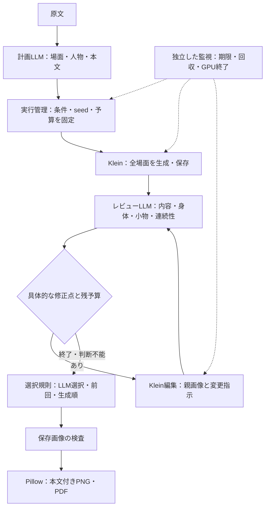

# Kleinへの集約と短編の完成

## 判断

生成と編集をKleinの標準グラフへ集約し、指定されたエンコーダーと二つのLoRAを共有する。モデルの優劣を一般化する判断ではなく、指定構成で作品を完成させるための選択である。画像の保存成功と画質の達成は別に報告する。

旧モデルの専用セット、品質タグ、追加ノード導入、段階合成用の検証コードを削除する。通常のモデル切替では保存済みの作品・モデル・履歴を移行・削除せず、履歴の設定を新規生成の設定型から分離する。利用者が指定した検証データの削除は、[容量整理の手順](../operations/artifacts.md#検証後の大幅な容量整理)に従う。旧セットへの互換処理や代替モデルは設けない。

## 実行と転送

全モデルの取得とハッシュ照合をGPU確保より先に行う。公式Colab CLIのuploadは全ファイルのbase64化を行うため、大容量モデルには既存の公式SSHアダプターを使うOpenSSH scpを採用する。パッケージ転送は公式CLIを使用する。モデルはGPU側でも照合してから確定する。

SFTPの要求数とバッファーは大容量ファイルの転送に合わせ、Colabアダプターの定数へ置く。OpenSSHのSFTPオプションに対応するクライアントを使用する。転送待機は所有記録の送信期限で制限し、モデルの大きさに関係なく短い起動待機時間を適用しない。準備途中で監視が失われた場合は、同じ所有ID、設定、GPUコードを確認して準備を再開する。

セッション開始時刻と期限を所有記録へ保存する。再接続で時計をリセットしない。起動を待つCLI、監視、GPU側の受付制御はLLMの応答を待たずに期限を適用する。停止が確認できなければ所有記録を残す。

## 完成処理

計画と画像レビューだけをLLMの役割とし、実行、予算、選択、保存、組版を通常のコードへ置く。固定短編の完走補助はtests/liveへ置き、汎用の常駐エージェント基盤を追加しない。Fake応答は対応する原文と対で扱う。

全場面を先に保存し、具体的な修正点がある場面だけを制限内で編集する。有効なLLM選択を優先し、判断不能なら直前の選択、初回なら生成順と候補位置で有効画像を選ぶ。選択と品質評価は分け、欠損や破損画像で完成扱いにしない。

## 運用への反映と検証資料

実装、通常環境への反映、実機確認、画質合格を区別する。受入検証は普段使う作業フォルダーと起動経路から行い、別の作業ツリーだけで成功したことを通常環境への反映とは扱わない。ブラウザーの名前ではなく、読み込み元、GPUの資源、保存された実行グラフを根拠にする。

LoRAのキー形式は標準の変換処理と照合し、ファイルの存在やノード接続だけで適用を断定しない。有効・無効の比較では他の条件を固定し、一つのseedの結果をモデル全体の性能へ一般化しない。身体や小物の接続を繰り返し修正できない場合は、同じ編集を重ねる前に対象の重なりとカメラ位置を見直す。

改善指示を作る前に、保存済み本文と画像条件を読み、変える箇所と維持する動作を記録する。手や小物が改善しても、歩く場面をしゃがむ姿へ変えた候補は採用しない。親画像と場面IDの一致は、内容の一致を保証しない。

画像の用途はRunの主出力・補助出力と場面の対応から確認する。単体画像だけを並べて、背景素材、マスク、合成途中の画像を完成候補と判断しない。原文や入力が残っていない画像は、意図との一致を不明とする。一覧画像による一次確認と、実寸の候補画像による採否判定も分ける。

停止済みの旧制御記録が新しい設定型で読めない場合は、対象GPUの終了結果、所有ID、監視プロセスを照合してから、制御記録だけを退避する。現在の設定へ読み替える互換処理は追加しない。終了が確認できない記録にはこの整理を適用しない。

取得済みモデルを検証用workspaceへ共有する場合はハードリンクを使う。認証が必要なHugging Face資源の新規取得は標準SDKのlocal_dirを使い、検証後に同じボリューム内で正本へ確定する。キャッシュから正本への大型ファイルの追加コピーは行わない。未完了の取得は再開できる作業領域へ残す。

本文の組版は全パネルで共通の文字サイズを選び、実際の行数から段の高さを決める。短い最終行を調整する場合も本文を省略しない。検証後の資料は結果の要約と設計判断へ集約し、個別生成物の削除は利用者が指定した範囲で行う。

