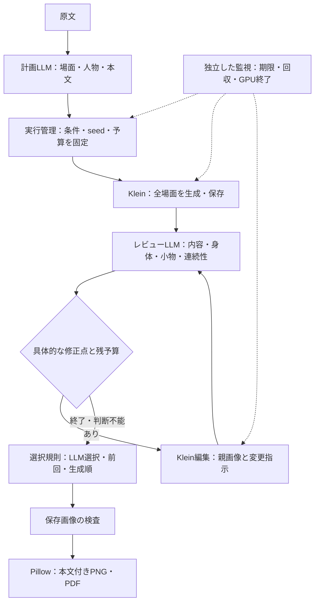

# Kleinへの集約と短編の完成

## 判断

生成と編集をKleinの標準グラフへ集約し、指定されたエンコーダーと二つのLoRAを共有する。モデルの優劣を一般化する判断ではなく、指定構成で作品を完成させるための選択である。画像の保存成功と画質の達成は別に報告する。

旧モデルの専用セット、品質タグ、追加ノード導入、段階合成用の検証コードを削除する。保存済みの作品・モデル・履歴は移行や削除を行わず、履歴の設定を新規生成の設定型から分離する。旧セットへの互換処理や代替モデルは設けない。

## 実行と転送

全モデルの取得とハッシュ照合をGPU確保より先に行う。公式Colab CLIのuploadは全ファイルのbase64化を行うため、大容量モデルには既存の公式SSHアダプターを使うOpenSSH scpを採用する。パッケージ転送は公式CLIを使用する。モデルはGPU側でも照合してから確定する。

SFTPの要求数とバッファーは大容量ファイルの転送に合わせ、Colabアダプターの定数へ置く。OpenSSHのSFTPオプションに対応するクライアントを使用する。転送待機は所有記録の送信期限で制限し、モデルの大きさに関係なく短い起動待機時間を適用しない。準備途中で監視が失われた場合は、同じ所有ID、設定、GPUコードを確認して準備を再開する。

セッション開始時刻と期限を所有記録へ保存する。再接続で時計をリセットしない。起動を待つCLI、監視、GPU側の受付制御はLLMの応答を待たずに期限を適用する。停止が確認できなければ所有記録を残す。

## 完成処理

計画と画像レビューだけをLLMの役割とし、実行、予算、選択、保存、組版を通常のコードへ置く。固定短編の完走補助はtests/liveへ置き、汎用の常駐エージェント基盤を追加しない。Fake応答は対応する原文と対で扱う。

全場面を先に保存し、具体的な修正点がある場面だけを制限内で編集する。有効なLLM選択を優先し、判断不能なら直前の選択、初回なら生成順と候補位置で有効画像を選ぶ。選択と品質評価は分け、欠損や破損画像で完成扱いにしない。

