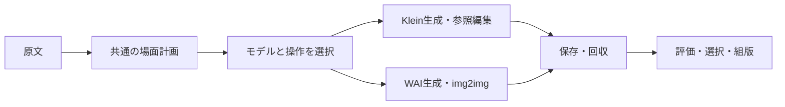

# モデルと操作の共通化、Colabへの直接取得

状態: 採用。対象要件: REQ-MODEL-INTERFACE、REQ-ASSETS、REQ-KLEIN、REQ-KLEIN-SWITCH。

## 判断

原文から可視対象と状態を計画する責務と、画像モデルの条件を適用する責務を分ける。同じ確定計画からモデルごとにRenderを作り、再計画と上書きを行わない。公開入力はモデルと操作に揃え、モデル固有の能力は固定ワークフローと宣言済みパラメータで扱う。

Kleinを基準にした場面仕様を維持し、WAIに専用の計画LLMを追加しない。品質タグと負条件は描画設定へ分離する。Kleinでは負条件を拒否し、WAIは未指定・置換・無効化を区別する。

App ModeとAPIは同じ標準JSONと入力対応を使う。普段使う設定をApp Modeへ出し、詳細なNode Graphを残す。LoRA数を共通処理へ固定しない。Party TimeとKlein FixesをAniEditへ置き換え、Pony由来の品質タグやCLIP設定を持ち込まない。

## 取得と容量

PCのモデル正本とGPUへのSCP転送は、容量の二重消費と、帯域による準備期限超過を招いた。固定版・サイズ・SHA256・利用条件・アクセス権はPCで確認し、モデル実体はColabへ直接取得する。モデル資源の正本は配布情報と内容ハッシュとする。

認証はPCの標準ストアに置く。所有IDとコードを確認した取得専用のSSH標準入力で一時的に渡し、引数、環境、設定、ログ、トークンファイルへ保存しない。公開GETで取得できる資源に追加認証を要求しない。HEADを拒否する配布元があるため、権限確認は少量のGETで行う。

準備ジョブの完了はGPU上の照合で決める。ローカル保存の完了待ちとモデルアップロードを削除し、版の異なる旧準備サーバーへ暗黙接続しない。資源排他と部分取得を使い、通信断では同じジョブIDを照合する。

## 保存と検証

旧設定・コンパイル済み入力は読み取り型へ隔離する。既存の値とハッシュを変更せず、既送信要求の回収を維持する。生成条件を変えるときは新しいRenderを作る。

実装、保存、実機確認、画質、原因解決、容量解放を分ける。画像の問題は新しい実画像で確認するまで解決扱いにしない。二段階生成と全場面の最終仕上げは保留し、専用の実行状態を追加しない。
